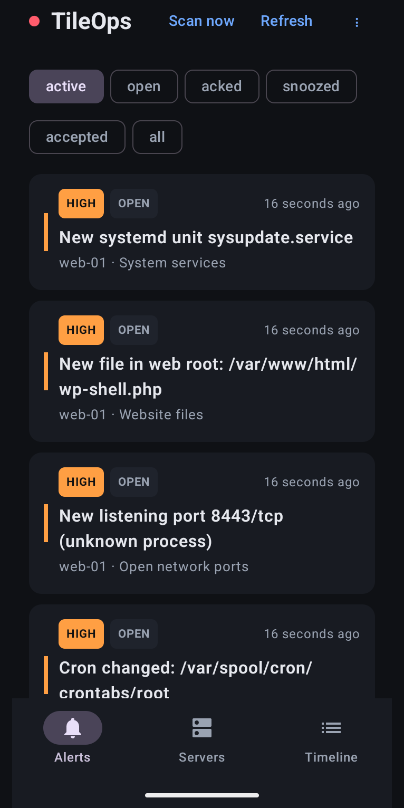
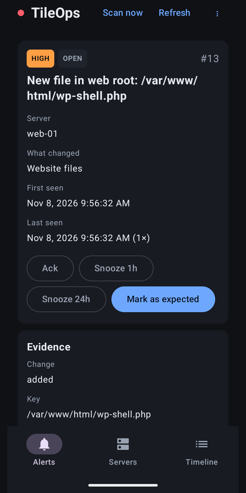
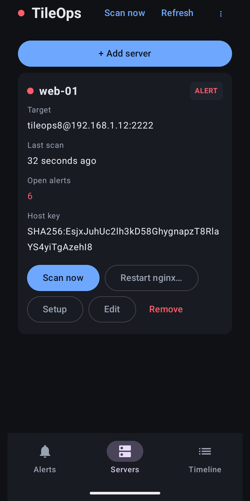
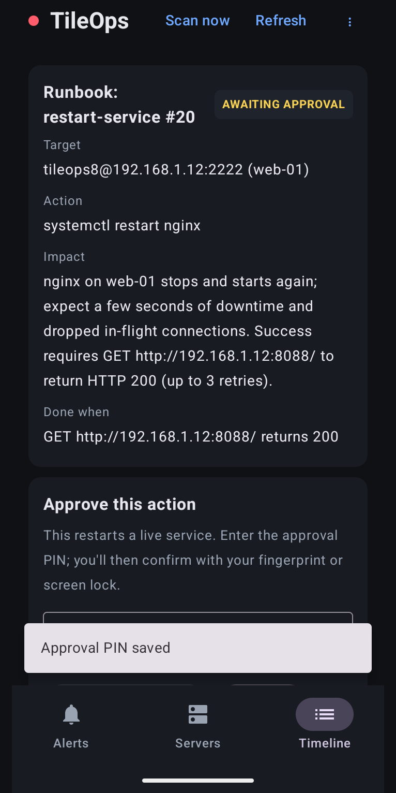

# TileOps

**Know the moment something changes on your servers.**
TileOps is an agentless server security monitor you run from your Android phone. No agent, no account, no cloud.

## What it does
TileOps logs in to your Linux servers over SSH with its own **limited** user, runs a fixed set of **read-only** checks, records what's normal, and alerts you when something changes:

| Check | Typical meaning |
|---|---|
| New user account (uid 0 = critical) | backdoor account |
| New/changed SSH `authorized_keys` line | persistent access |
| New/changed cron job | persistence, crypto-miners |
| New listening port | backdoor/bind shell, forgotten service |
| Unknown process above a CPU threshold (2 scans in a row) | crypto-miner |
| New/modified file in your web root | web shell, defacement |
| New/changed systemd unit | persistence |

Every alert carries evidence (what changed, before/after, the exact command output and when). You can **acknowledge**, **snooze**, or **mark as expected** (new baseline). Restarting an allow-listed service needs your **PIN plus fingerprint/screen lock**, and only counts as done when your health-check URL answers again. Every step goes to an incident timeline.

## Two ways to run it
| | **Just this phone** | **Always-on companion** |
|---|---|---|
| Setup | Install the app, add a server | Run the companion on an always-on Linux box ([guide](docs/companion-setup.md)), pair the app |
| Checks | When you open the app / tap *Scan now*, and in the background when Android allows | Every 5 minutes, 24/7 |
| Alerts | Notifications from the app | Push via ntfy even when your phone is off, plus the app |

Both use the same server setup, checks and alerts. Servers that are **only reachable over a VPN** can be marked as such: TileOps checks them while your VPN app (e.g. OpenVPN Connect) is connected and quietly waits otherwise.

## Install
Download the latest APK from **[Releases](https://github.com/Sathya-github-del/tileops/releases)** (Android 13 or newer), verify its SHA-256 against `SHA256SUMS`, and open it (allow "Install unknown apps" for your browser or file manager).

## Add a server
1. **Servers → + Add server** in the app.
2. Copy the **setup command** it shows, log in to the server with any SSH app as root or a sudo user (your own password; TileOps never sees it), paste and run it. It must end with `TILEOPS SETUP OK`. *What does it do?* shows the readable script: it creates the limited user, installs TileOps' public key, a read-only helper (`/usr/local/sbin/tileops-read`) and an exact-command sudoers file. Nothing else changes.
3. **Confirm the server's identity**: compare the host-key fingerprint with the one the setup printed, then trust it.
4. **Test** and run the **first scan** (records the baseline).

## Security model
- Agentless: only a limited user, a 40-line read-only helper and exact sudo rules on the server. No arbitrary command execution anywhere: probe commands are a fixed list; restarts are typed actions for allow-listed services.
- Server host keys are pinned per server; app-added servers are never trusted on first use without your confirmation.
- Phone-only mode keeps server keys and all data encrypted on the device (Android Keystore). The companion serves HTTPS with its own certificate, which the app pins via the pairing QR/link.
- No accounts, analytics, ads or tracking. See the [privacy policy](docs/release/privacy-policy.md).

Found a vulnerability? See [SECURITY.md](SECURITY.md).

## Build from source
- **App** (`android/`): Kotlin + Jetpack Compose. JDK 17 and the Android SDK (platform 37); then `cd android && ./gradlew assembleDebug`. Release builds are signed with the key in `secrets/upload-keystore.properties` if present.
- **Companion** (`companion/`): Python 3.11+, `pip install -r requirements.txt`, `python -m companion -c config.yaml serve`. See [docs/companion-setup.md](docs/companion-setup.md).
- **Tests:** `python -m pytest` (integration tests need the demo container from `deploy/target/setup-target.sh`), `cd android && ./gradlew testDebugUnitTest`.

## Licence
TileOps is free software under the **GNU General Public License v3.0 or later** ([LICENSE](LICENSE)). Third-party components and their licences are listed in the app under *About → Open-source licences*.

**Author:** Sathya Prakash J, creator & lead developer · © 2026
